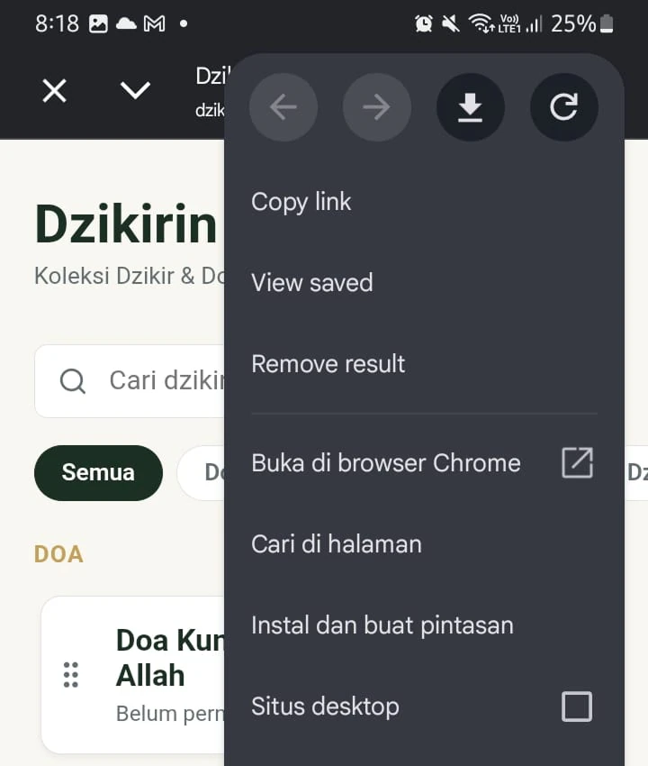
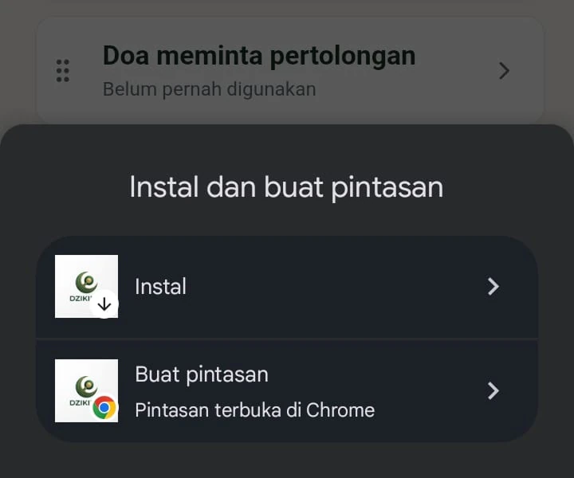

## Tentang Aplikasi

Berawal dari masalah pribadi, seringkali saya ingin berdoa dan berdzikir namun sering lupa akan doanya, atau belum hafal artinya, sehingga saya membuat aplikasi ini agar lebih mudah dalam berdzikir dan berdoa.

## Fitur

- Terdapat dzikir dan doa pilihan
- Add dzikir dan doa sendiri
- Terdapat tasbih Digital dengan jumlah hitungan dan batas hitungan yang dapat diatur

## Cara Instal

1. Buka di google app
2. Klik titik 3 di kanan atas
3. Klik "Instal dan buat pintasan"
4. Klik "Instal"

<!-- > **Perhatian:** Gunakan tool ini hanya jika printer menampilkan pesan waste ink full. -->
