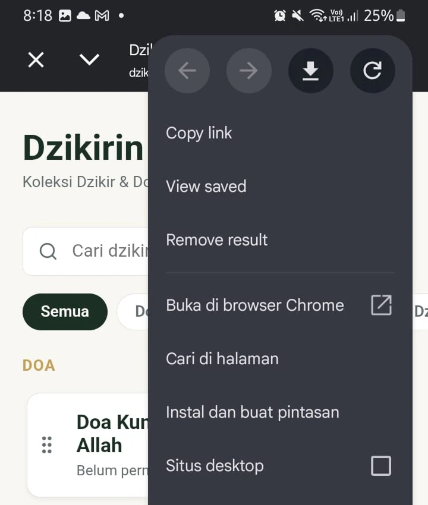
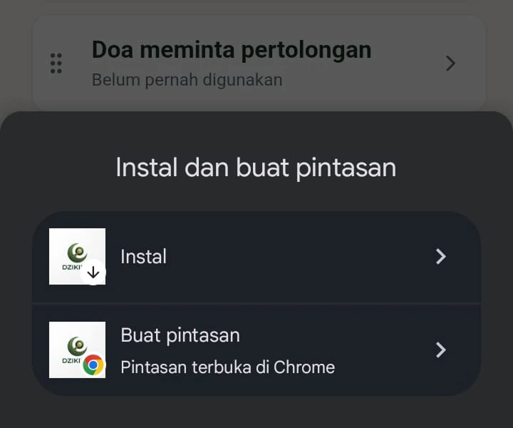

## Tentang Aplikasi

Alquran digital untuk mempermudah menghafal quran dengan artinya, dilengkapi dengan audio bacaan.

## Fitur

- Menampilkan 1 kata tiap ayat, sehingga dapat fokus untuk menghafal
- Audio per Ayat
- Audio per Surah
- Multiple repeat (play beberapa ayat tertentu secara berulang)

## Cara Instal

1. Buka di google app
2. Klik titik 3 di kanan atas
3. Klik "Instal dan buat pintasan"
4. Klik "Instal"

<!-- > **Perhatian:** Gunakan tool ini hanya jika printer menampilkan pesan waste ink full. -->
